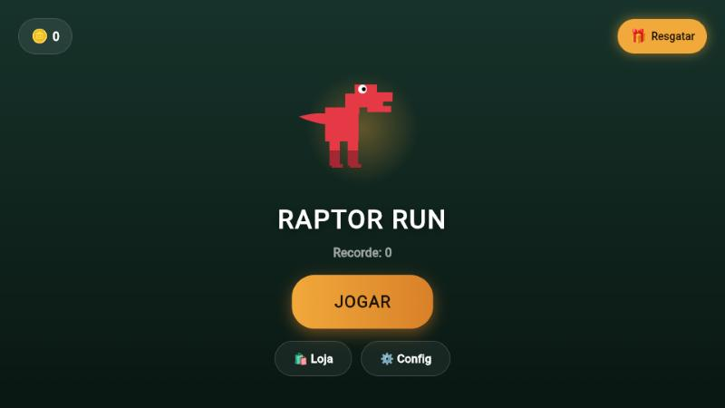

# Raptor Run

**Jogo de corrida infinita com um dinossauro**, feito do zero em Flutter para Android e iOS. Toda a arte e todos os sons são gerados por código: não existe nenhum arquivo de imagem nem música de terceiros.

Jogue no navegador: **[dazevedo.dev/portfolio/raptor-run](https://dazevedo.dev/portfolio/raptor-run)**



## O jogo

- Pula e abaixa para desviar dos obstáculos, por toque, deslize ou botões na tela.
- **Três mundos**, que mudam com a distância percorrida:
  - **Dia:** cidade, cactos coloridos e passarinhos;
  - **Extinção:** vulcões, rochas e pterodáctilos;
  - **Noite:** a cidade de novo, com céu escuro, lua e janelas acesas.
- A dificuldade vem só da velocidade, que aumenta com a distância. A física do pulo garante que todo obstáculo pode ser pulado: o jogo fica mais difícil, mas nunca impossível.
- Moedas durante a corrida, recorde e **recompensa diária** que cresce com os dias seguidos.
- Loja (personagens e skins estão a caminho), configurações de som e de controle, e um tutorial na primeira partida.

## Como foi feito

- **Flutter puro**, sem engine de jogo: o loop, a física e as colisões ficam em `lib/screens/game_screen.dart`.
- **Arte por código:** o dinossauro, o cenário e os obstáculos são desenhados com `CustomPainter` (`lib/game/dino_painter.dart` e `character_renderer.dart`). O ícone do app é gerado pelo mesmo código.
- **Som por código:** `tool/generate_audio.dart` sintetiza a música e os efeitos com ondas senoidais, quadradas e triangulares calculadas na mão. Por isso não há risco de direitos autorais.
- Progresso salvo no aparelho com `shared_preferences`.

## Stack

Flutter · Dart · `shared_preferences` · `audioplayers`

## Rodando

```bash
flutter pub get
flutter run                                    # Android ou iOS
flutter run -d web-server --web-port 8765      # teste rápido no navegador
```

As notas completas de desenvolvimento, com a estrutura das pastas e as regras do jogo, estão em [`docs/NOTAS-DE-DESENVOLVIMENTO.md`](docs/NOTAS-DE-DESENVOLVIMENTO.md).

---

Feito por [Daniel Dazevedo](https://dazevedo.dev) · DAZEVEDO
